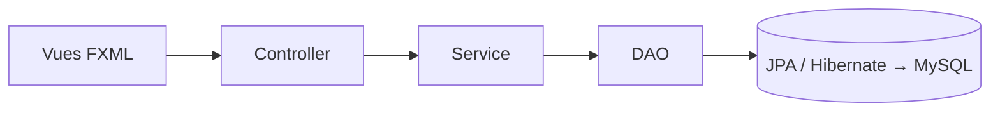

# Gestion de produits · JavaFX, JPA et code propre

Application de bureau **JavaFX** de gestion de produits et de catégories, construite avec **JPA / Hibernate** et **MySQL**, en architecture en couches et selon les principes **SOLID**. Projet support de cours.


## Architecture en couches



| Couche | Paquet | Responsabilité |
|---|---|---|
| Vue | `resources/.../views` | Écrans FXML : mise en page, liste et ajout de catégories |
| Contrôleur | `Controller` | Réagit aux actions de l'utilisateur, ne contient pas de logique métier |
| Service | `Service` | Logique métier et gestion des transactions |
| Accès aux données | `DAO` | Opérations JPA sur les entités |
| Modèle | `Model` | Entités `Categorie` et `Produit` |
| Configuration | `config/FactoryJPA` | Création unique de l'`EntityManagerFactory` |
| Utilitaire | `Utilitaire/Navigation` | Chargement des vues dans la mise en page principale |

**Principes appliqués :** responsabilité unique par classe, injection du DAO dans le service par le constructeur, navigation centralisée, configuration de la persistance isolée.

## Lancer le projet

Prérequis : Java 17 ou plus, MySQL.

1. Crée la base : `CREATE DATABASE reservations;`
2. Adapte l'utilisateur et le mot de passe dans `src/main/resources/META-INF/persistence.xml`.
3. Lance l'application :

```bash
./mvnw clean javafx:run
```

## Ce que ce projet montre

Séparation des responsabilités dans une application de bureau, persistance JPA, navigation entre vues FXML et code lisible pour l'apprentissage.

---

Réalisé par **Stephanos Langate** · [Masseka Academy](https://www.youtube.com/@massekaacademy)
